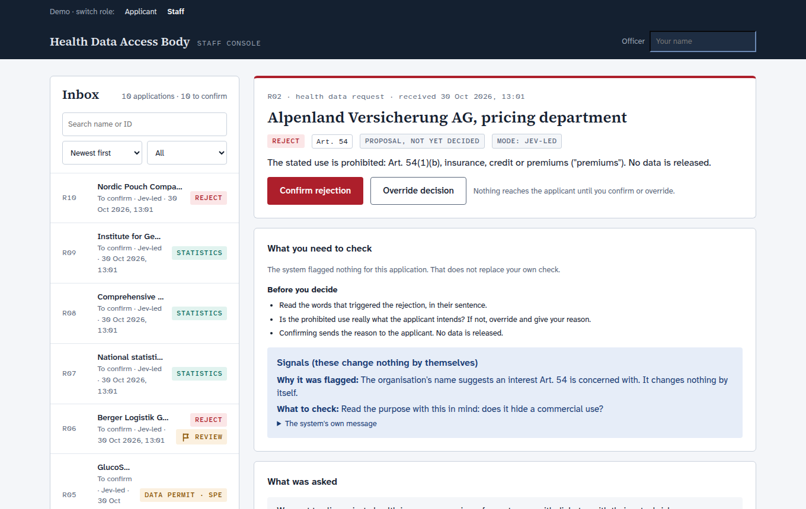
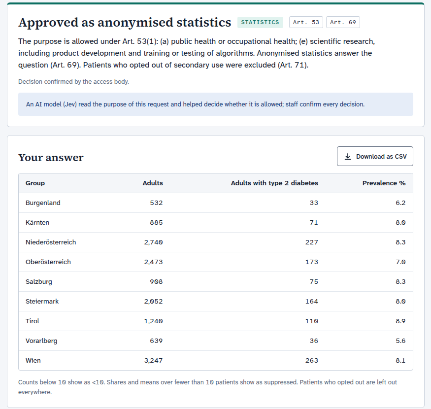
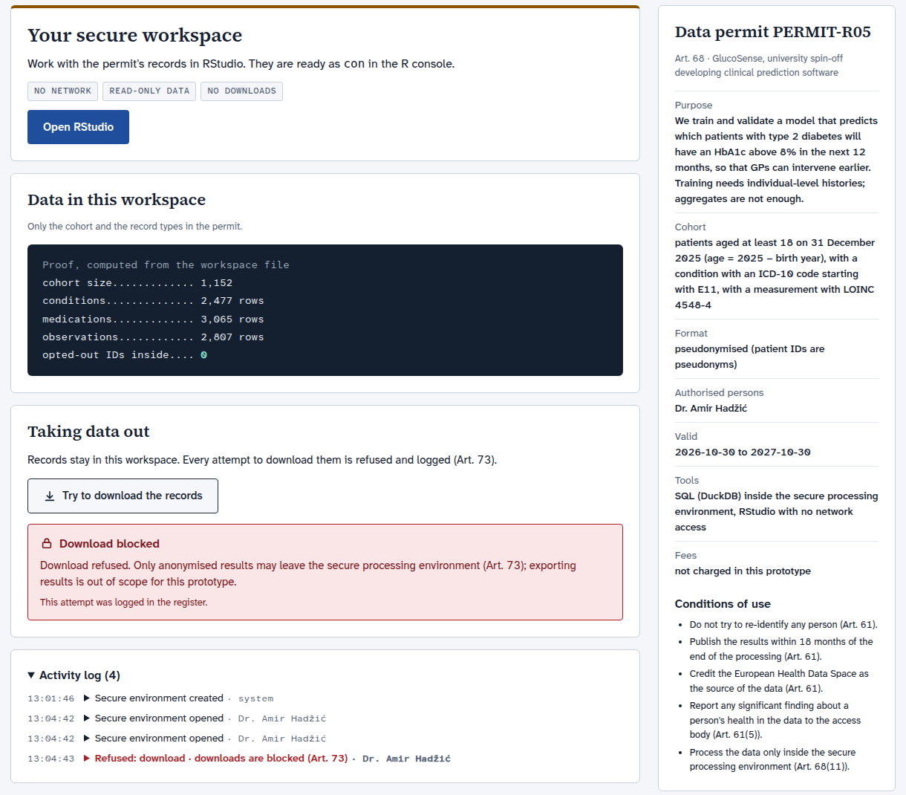
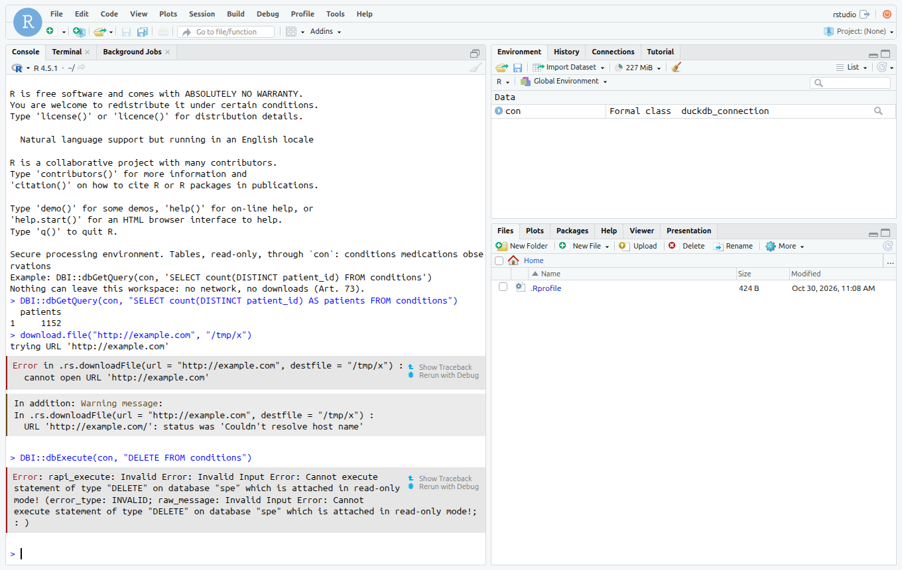
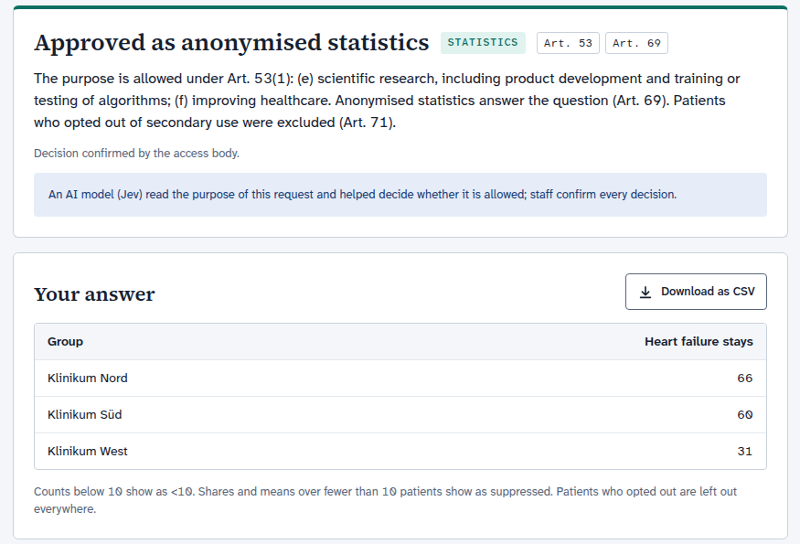
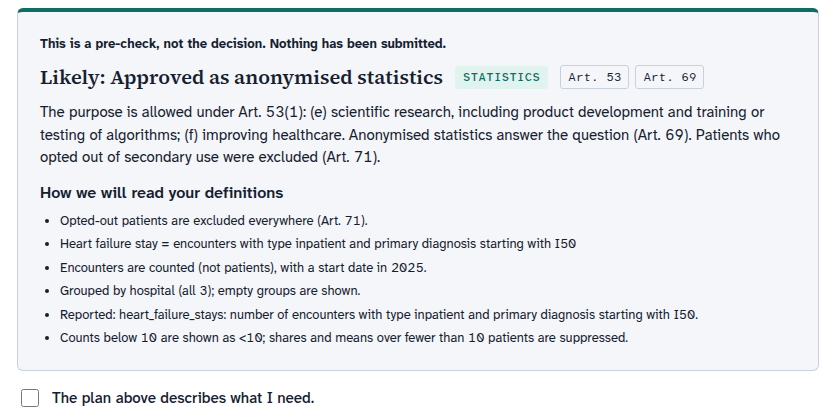
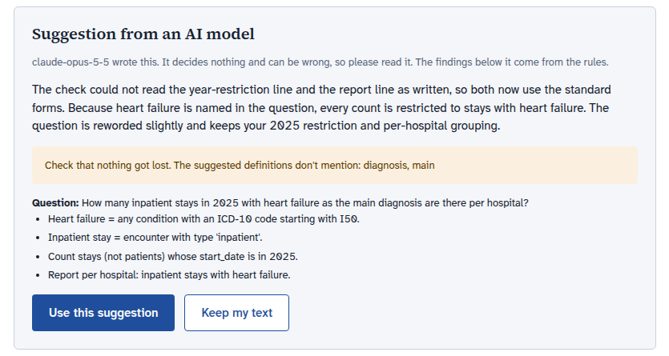
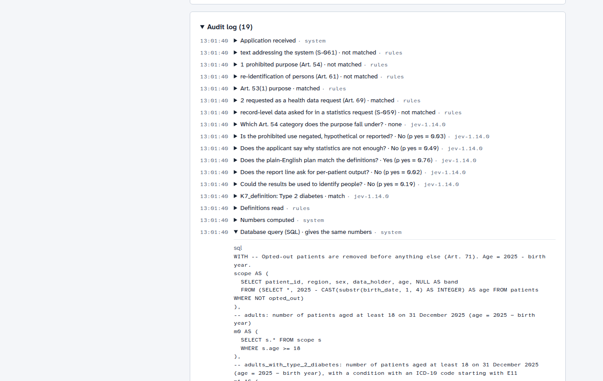
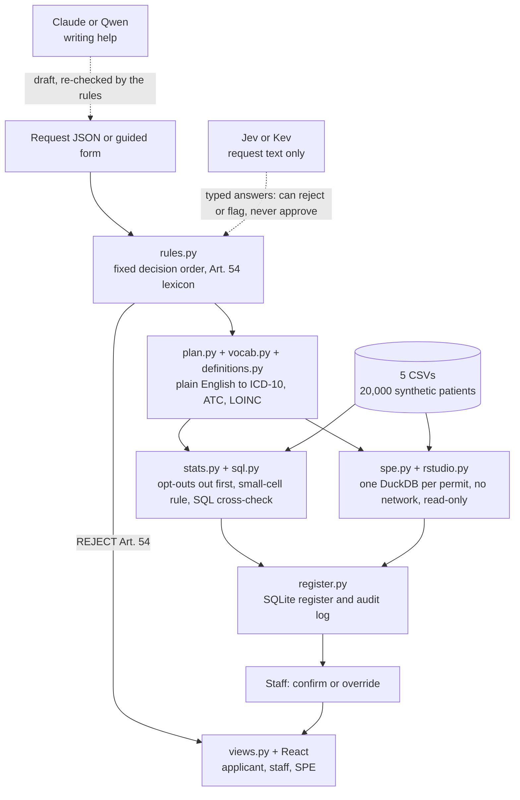

# Health Data Access Body

**[▶ Try it out right now](https://spare-love-inclusive-postage.trycloudflare.com/apply)** (online until 22:00 Vienna time, 30 Oct) &nbsp;**or**&nbsp; **[Set it up yourself](#run-it-yourself)**

### Every EHDS data request decided in about two seconds. Every article cited. Every number safe. A human signs off every time.

**AIM Healthcare Hackathon Vienna 2026 · Track 3: European Health Data Space**

**10/10** correct decisions · **6/6** correct numbers · **0** privacy leaks · **10/10** consistent over 3 runs · **2.07 s** slowest answer (target: 60 s)



> **Demo video:** ⏳ link added at submission · **Metrics:** [results on the 10 requests](#metric-results) · **Run it:** [five commands](#run-it-yourself)

## Why this one

Most LLM demos ask you to trust the model. We built an access body that cannot be talked into a bad approval:

- **Fixed rules decide. Models only read.** The challenge's decision order is code, not a prompt. A model can reject what the keyword rules miss or send a case to a human. **It can never approve on its own.**
- **Doubt goes to a human, never to approval.** Anything the app cannot fully read goes to `needs_review` and gets no numbers. It does not guess.
- **We attacked it before you could.** 113 extra adversarial, messy and unseen requests. For the jury simulation and both holdouts, the expected outcomes were written down *before* the first run, and the jury simulation's numbers are checked against a separate oracle that shares no code with the app.
- **Every number proves itself.** Each statistic is computed in pandas, re-run as generated SQL, and compared. The staff log shows the query and says whether it gives the same numbers.
- **The download block is real.** The API refuses, the RStudio container has no network, the data is read-only, and a proxy closes RStudio's download routes. The attempts shown below all failed.
- **No lock-in.** Flagship models for the demo, open models one setting away, and no model at all if you prefer. See [Models](#models-flagship-today-your-own-hardware-tomorrow).

## What the jury can try

### Rejected, with the law and the words that triggered it
Above: R02, an insurer's pricing department, stopped at Art. 54(1)(b), with the trigger word `premiums` quoted. No data is released, and the applicant reads the same reason in plain language.

### Numbers an applicant can trust, released only after an officer confirms



### A real secure processing environment, and a download that fails

R05 gets a permit and a DuckDB workspace holding exactly the **1,152** selected patients (1,207 if opt-outs were wrongly included) and only the requested record types. The proof panel is computed from the workspace file, and shows **0** opted-out IDs inside. The refusal lands in the audit log.



And it is not a mock-up. Researchers get a live RStudio session. In this one, R reads the cohort, `download.file` cannot reach the internet, and `DELETE` hits a read-only database:



### A brand-new request, on the two features none of the 10 use

The challenge warns that the jury can filter by main diagnosis (`primary_icd10`) and group by hospital (`data_holder`). Nothing is written per request: this one went through the form and came back answered.



### Applicants see how the app reads them, before they send

The pre-check restates each definition in plain English, and the applicant must confirm that reading. An access application that does not say why statistics are not enough is refused here.



Stuck? **Help me write this** drafts the question and definitions. The rules re-check every draft, the applicant must accept it, and the app warns when words go missing. Here it noticed "main diagnosis" had been dropped:



### An audit trail staff can open line by line

Every rule step and every model answer is its own entry, with its evidence or the model's instructions, input and probabilities. Numbers stay out of the log.



## Metric results

Measured on 30 Oct 2026 with [`scripts/metrics.py`](scripts/metrics.py) on the `expected.json` of the 10 requests, 3 runs each.

| Metric | Target | **Jev-led (demo)** | Rules only (no model) |
|---|---|---|---|
| Correct decisions | 10 of 10 | **10 of 10** | **10 of 10** |
| Correct numbers | 6 of 6 | **6 of 6** | **6 of 6** |
| Privacy leaks | 0 | **0** | **0** |
| Consistency | 10 of 10 | **10 of 10** | **10 of 10** |
| Slowest answer | under 60 s | **2.07 s** | **0.42 s** |

Reproduce: `make metrics` (rules only), or `KEV_MODE=led KEV_PROVIDER=jev make metrics` with `TYPESAFE_API_KEY` exported in your shell. `scripts/metrics.py` does not read `.env`; without the key the run falls back to rules and is not a Jev-led measurement.

### Beyond the 10

| Test | Requests | Rules only | Jev-led |
|---|---|---|---|
| Jury simulation (`make jury`): new, messy, broken | 49 | **49/49**, numbers match the independent oracle | not run |
| Red team (`make redteam`), tuned on | 30 | **30/30**, 0 silent | 27/30, 0 silent |
| Holdout 1, rules tuned afterwards | 17 | 15/17, 0 silent | 15/17, 0 silent |
| **Holdout 2, unseen** | 17 | 8/17, **2 silent** | **15/17, 0 silent** |
| `make test` | 360+ tests | all pass | models mocked |

"Silent" means a wrong approval with no review flag, the one failure an access body cannot undo. **Holdout 2 is why the demo runs with a model:** on unseen wording, keyword rules let two bad requests through and the model-assisted mode let none through. All 7 Jev-led misses are on the cautious side: 5 harmless requests went to a human instead of being approved, and 2 went to rejection instead of review. Results shift slightly between runs (holdout 2 scored 16/17 on an earlier run), because the hosted model can change.

## Architecture

We built the decision pipeline, the query planner, the statistics engine, the SPE, the register and the web app. The rest is open-source infrastructure and two optional models.



| Component | What it does |
|---|---|
| `src/hdab/pipeline.py` | The single entry point: `decide` (pure), `submit`, `confirm`, `override` |
| `src/hdab/rules.py` | The challenge's decision order, Art. 53/54/61 checks, trace with evidence words, prompt-injection check |
| `src/hdab/plan.py`, `vocab.py` | Definitions to query plan. Every word must be claimed by the parser, otherwise the request goes to review |
| `src/hdab/definitions.py`, `icd10.py`, `sanity.py` | Do the codes mean what the definition says? Does the request make sense at all? Finds contradictory ages and empty cohorts |
| `src/hdab/stats.py`, `sql.py` | Small-cell-safe statistics, and the generated SQL that must reproduce them |
| `src/hdab/spe.py`, `rstudio.py` | Permit, cohort copy, blocked downloads, RStudio with `--network none` |
| `src/hdab/kev.py`, `assist.py` | The only places a model is called. Fixed, typed questions; a draft helper that decides nothing |
| `src/hdab/register.py`, `views.py`, `api.py` | Audit log, role-based views (applicants never see review reasons or model answers), FastAPI ([endpoints](docs/API.md)) |
| `frontend/` | React and TypeScript. It only renders; every decision comes from the backend |

Data stays where it is: pandas over the CSVs, one central store, no OMOP or FHIR conversion. **Patient-level data never leaves the app.** Models receive request text only.

## Models: flagship today, your own hardware tomorrow

The demo runs the strongest models we could reach, because that is what the numbers justify. Both are **closed, hosted services**: their weights cannot be self-hosted. So each one has an open replacement behind one setting, and the rules work with no model at all.

| Job | In the demo (closed, hosted) | Self-hosted replacement (open weights) | Status of the replacement |
|---|---|---|---|
| Reads the purpose, can reject or flag | TypeSafe **Jev** | **Kev-4B**, Apache-2.0: `KEV_PROVIDER=kev` | Deployed and measured on an RTX 4060 Ti. It understands the text but is not yet calibrated: holdout 2 at 8/17, 1 silent. **Not at Jev's level** |
| | | **Kev-27B** on one RTX PRO 6000 | **The way to run without a hosted model. Not deployed or measured here** |
| Helps applicants write | Anthropic **Claude Opus 5.5** | **Qwen3.8 27B**, Apache-2.0: `ASSIST_PROVIDER=ollama` | Ran through the app on an RTX A5000, about 6 s for a draft. Output quality not formally compared |
| Decides | Nobody but the rules and the officer | Rules only: `KEV_MODE=off` | **10/10, 6/6 with no model at all**, but see holdout 2 above |

**What goes out, in demo mode:** request text, including the applicant's name, to TypeSafe; the draft's purpose, question and definitions plus the rules' findings to Anthropic. Never patient rows. In Jev-led mode the app is an AI system under the EU AI Act. With `KEV_MODE=off` and the writing help off, it has no machine-learned component.

## Open source

Everything we run ourselves is open source. Our code is [MIT](LICENSE). The hosted models above are the deliberate exception and are listed as closed.

| Component | Licence |
|---|---|
| This repository | MIT |
| fastapi, pydantic, rich, duckdb, pytest, ruff | MIT |
| pandas, numpy, httpx, uvicorn, starlette, python-dotenv | BSD-3-Clause (numpy also has 0BSD, MIT, Zlib and CC0-1.0 parts) |
| anthropic Python SDK | Apache-2.0 |
| React, React Router, Vite | MIT |
| TypeScript | Apache-2.0 |
| Atkinson Hyperlegible and Source Serif fonts | OFL-1.1 |
| RStudio Server in the SPE (`rocker/rstudio`) | AGPL-3 |
| R, DuckDB R driver | GPL, MIT |
| nginx (RStudio proxy) | BSD-2-Clause |
| Ollama | MIT |
| Kev server code and Kev-4B weights (optional) | Apache-2.0 |
| `qwen3.8:27b` weights (optional) | Apache-2.0 |
| Qwen3.5-4B-Base, Kev's base model (optional) | ⏳ not verified yet |
| NVIDIA CUDA runtime, used by Kev (optional) | ⏳ proprietary; an open question against our own open-source rule |
| TypeSafe Jev, Claude Opus 5.5 (hosted, optional) | **closed** |
| WHO ICD-10 2019 file (optional, not in this repo) | © WHO; redistribution needs permission |

## Run it yourself

You need [`uv`](https://docs.astral.sh/uv/) and Node. **For the best experience we highly recommend a TypeSafe key and an Anthropic key:** they power the purpose reader (Jev) and the writing help (Claude), exactly as in the live demo. If you prefer self-hosting, both can be replaced with open-source endpoints.

```bash
git clone --recursive https://github.com/noah-stockinger/ehds-access-body.git && cd ehds-access-body
uv sync
cp .env.example .env                        # add TYPESAFE_API_KEY and ANTHROPIC_API_KEY
make seed && make dev                       # API on :8000, docs at /docs
cd frontend && npm install && npm run dev   # second terminal: http://localhost:5173
```

**Self-hosted:** `make seed KEV_PROVIDER=kev && make dev KEV_PROVIDER=kev ASSIST_PROVIDER=ollama` uses Kev-4B and Qwen3.8 27B instead. See [Models](#models-flagship-today-your-own-hardware-tomorrow) for what each one needs and how it compares.

**No keys:** `make seed KEV_MODE=off && make dev KEV_MODE=off ASSIST_ENABLED=false` runs the rules alone, without purpose reading or writing help. Plain `make dev` without keys flags every request for review (`Rules only (Jev unreachable)`).

**RStudio in the SPE** needs Docker: `make spe-image`, once.

**Windows:** use `git clone --recurse-submodules`. `make` needs Git Bash or WSL; the `uv run ...` commands behind each target also work in PowerShell.

**Send your own request:** the fastest jury test.
```bash
curl -s localhost:8000/requests -H 'content-type: application/json' -d @data/track3/requests/R01.json
```

| Command | What it does |
|---|---|
| `make metrics` | R01–R10 against `expected.json`, 3 runs |
| `make jury` | 49 new, messy and broken requests |
| `make redteam` | 30 adversarial and paraphrased requests |
| `make test` | 360+ tests, no GPU or API key needed (35 need the WHO file and skip without it) |
| `curl -X POST localhost:8000/demo/reset` | Clean slate: R01–R10 back as proposals |

Screens and the click-by-click walkthrough: [`frontend/README.md`](frontend/README.md).

**Optional ICD-10 check:** WHO's file is not redistributable, so it is not here. Put `icd102019en.xml` from <https://icd.who.int/browse10> in `data/icd10/` to get wrong-code warnings, including the one on R03. Without it, decisions and numbers are the same and the app says the codes were not checked.

## What works and what does not

**Works end to end:** the 10 requests and new ones, both roles, confirm and override (overriding deletes the SPE and ends the RStudio session), blocked downloads, the audit log, CSV export of released statistics.

**Does not, and we would rather you hear it from us:**

- **Unusual wording goes to review with no numbers.** The definition parser uses sentence templates. That is safe, but a valid request in an unfamiliar phrasing waits for a person instead of being answered.
- **Rules alone are weak on unseen wording** (holdout 2: 8/17, 2 silent). That is why the demo uses a model, at the cost of sending request text out.
- **`POST /requests` returns numbers immediately**, so the metrics can be measured automatically. Only the web screens hold them back until staff confirm ([D-05](DECISIONS.md)).
- **No accounts.** Anyone who can reach the backend can act as staff, and the officer name is typed in. The same goes for the RStudio port, which has no login ([D-10, D-11](DECISIONS.md)). Fine for synthetic data; required work before anything real.
- **The screen is still a way out.** A determined SPE user can copy what the browser displays. Results export review is not built, and what happens inside an R session is not logged.
- **Self-hosted is not yet at flagship quality** for the purpose reader. See [Models](#models-flagship-today-your-own-hardware-tomorrow).
- **Not certified.** A prototype, with no conformity assessment. Legal readings are ours, and [some are still being checked](docs/findings/article-check.md).

Every call we made where the specs conflicted is written down, with its costs, in [`DECISIONS.md`](DECISIONS.md).

## Find your way around

[`SPECS.md`](SPECS.md): the binding rules, each with a check · [`DECISIONS.md`](DECISIONS.md): trade-offs · [`docs/API.md`](docs/API.md): endpoints · [`docs/findings/`](docs/findings/): test reports · [`docs/SETUP-assist.md`](docs/SETUP-assist.md): self-hosting the writing help

**Synthetic data only.** The challenge and data are the organisers' ([`data/track3`](data/track3/README.md), a git submodule).
